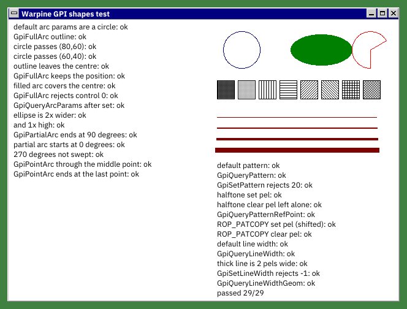
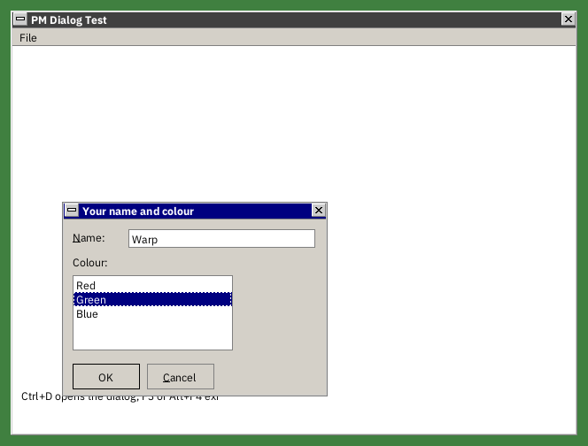
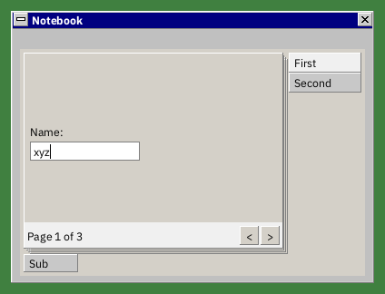
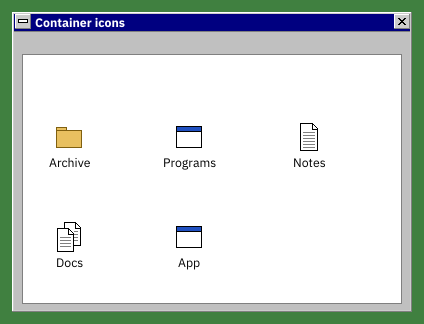
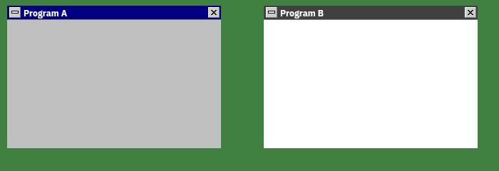
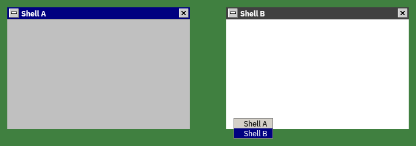
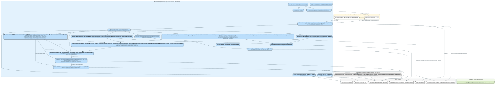

# Warpine: OS/2 Compatibility Layer

<picture>
  <source media="(prefers-color-scheme: dark)" srcset="doc/compat/api_coverage_dark.svg">
  
</picture>

*API coverage, generated from Warpine's source and a public dating of the OS/2 API by `gen_compat` (`cargo run --bin gen_compat -- table` prints it as text; data and sources in [doc/compat](doc/compat/SOURCES.md)).*

> ⚠️ **Experimental — not for production use.** Warpine is a research and hobby project, worked on in spare time at an irregular pace. APIs are incomplete, behaviour may be incorrect, and security has not been hardened. Use at your own risk.

Warpine is a compatibility layer that runs 32-bit OS/2 (LX format) and 16-bit OS/2 1.x (NE format) applications natively on Linux using KVM hardware virtualization. Analogous to WINE for Windows, but targeting OS/2 instead.

![The 4OS2 command shell in Warpine's 80×25 text window: its version banner, then the ver command and a wide dir listing of drive C:, ending at the [c:\\] prompt](doc/screenshots/4os2.png)

<!-- screenshots:begin -->
## Screenshots

### Working today

| | |
|---|---|
|  |  |
| **Typography.** Presentation Manager text is drawn in the embedded IBM Plex families: fonts chosen with `GpiCreateLogFont` (face, bold, italic, size) and CJK text in four DBCS codepages. The red rules are the widths reported by `GpiQueryTextBox`. | **Arcs, patterns and line widths.** `GpiFullArc` circles and ellipses, a `GpiPartialArc` wedge, the `PATSYM_*` area patterns and lines 1, 2, 4 and 8 pels wide. The text lists the sample's own checks, read back with `GpiQueryPel`: 29 of 29 pass. |
|  |  |
| **Built-in controls and typing.** The entry field was clicked and typed into (`Hello, Wörld!` at the end, then *Home* and `>>` at the start); in the multi-line field, Enter after "Line one" and `three` started a new line. | **Dialogs from the keyboard.** Ctrl+D, from the window's accelerator table, opens a modal dialog built from a `DLGTEMPLATE` resource. `Warp` was typed into the focused field, then Tab and Down twice picked *Green*. |
|  |  |
| **Sliders and value sets.** A scripted session clicked the shaft, dragged the arm, pressed a button and the arrow keys, and Shift+Right moved the arm to a detent; the red arm is drawn by the owner. In the value sets, clicks and keys selected items; "Two" is disabled. | **Notebooks.** `WC_NOTEBOOK` with major and minor tabs, a status line and page buttons. Clicks turned to the second page and back, and `xyz` was typed into the page's dialog, a dialog embedded in the notebook page. |
|  | ![4OS2 in a "Warpine — 4os2.exe" frame on the PM desktop, white on blue after color and cls: the ver command and a wide dir listing of drive C:, ending at the [c:\\] prompt](doc/screenshots/4os2_window.png) |
| **Containers.** `WC_CONTAINER` in the icon view, with system icons. The folder was renamed in place: Alt+click on its text, typing, and a click elsewhere, which asks the program for a buffer (`CN_REALLOCPSZ`). The text, name, detail and tree views, sorting and filtering work too. | **Text-mode programs in a PM window.** 4OS2 runs in a frame on the PM desktop, as in an OS/2 window session. The ANSI sequences it prints for `color` and `cls` are interpreted. `WARPINE_VIO=fullscreen` runs it full screen instead (the text window at the top of this page). |

|  |  |
| **One desktop per session.** Two separate PM programs — a parent and the child it started, each its own Warpine process — on the desktop of the session's desktop server. A was clicked last, so its title bar is the active one; keys and clicks reach the two programs in the order they were typed. | **The window list.** Ctrl+Esc in Shell A opens the session's switch list, which holds both programs' entries; Down has highlighted Shell B, and Enter would switch to it. |

### Work in progress

- **Containers and drag and drop** — container owner drawing, horizontal scrolling, tree lines and title editing are missing; drags work within a program and between programs, but not from the host desktop.
- **Text controls and pointers** — editing, selection, the clipboard and multi-select lists work; the pointer does not yet turn into an I-beam over text fields or a sizing arrow over frame borders.
- **Dialogs and menus** — programs cannot yet change system-menu items, and F10 for the menu bar and menus inside dialogs are missing.
- **More GPI** — rounded box corners, line ends and joins, scaled line widths, rotated glyphs and images under transforms, palettes, and drawing through a child window's presentation space are not implemented.
- **Games and video** — DIVE (direct framebuffer blitting) and OpenGL are not implemented yet.
- **Printing** — the spooler reports no printers.

_Screenshots captured from uncommitted changes on top of `ed65028` on 2026-11-18; the two-program desktop from uncommitted changes on top of `5cca292` on 2026-11-19; the window list from uncommitted changes on top of `8ae62bb` on 2026-11-19._
<!-- screenshots:end -->

## Key Features

- **LX Executable Parser:** Full support for LX headers, object tables, page maps, fixups, resource tables, import tables, entry tables, and non-resident names tables.
- **KVM Hypervisor:** Custom VMM executing 32-bit OS/2 code at native speed via hardware-accelerated virtualization.
- **API Thunking:** System call interception via `INT 3` traps bridging guest OS/2 calls to host Rust implementations. Covers DOSCALLS, QUECALLS, PMWIN, PMGPI, KBDCALLS, VIOCALLS, MOUCALLS, NLS, MSG, MDM (MMPM/2), UCONV, SO32DLL, TCP32DLL, PMSHAPI, HELPMGR, PMSPL and PMCTLS, plus Warpine's own WARPINE.DLL — 624 entry points total.
- **DLL Loader Chain:** Runtime dynamic loading via `DosLoadModule` / `DosQueryProcAddr` / `DosQueryModuleHandle`. User DLLs are loaded into guest memory with rebased objects and export maps. `jpos2dll.dll` (4OS2 extension) loads and resolves all 7 exports at startup.
- **Multi-Threading:** OS/2 threads mapped 1:1 to host threads, each with its own KVM vCPU; ending a thread ends only that thread, `DosWaitThread` / `DosKillThread` / `DosSuspendThread` / `DosResumeThread` follow the Control Program Reference, a thread spinning in its own code can be stopped (each vCPU can be kicked out of the guest), signal exceptions reach thread 1, and vCPUs of ended threads are reused.
- **Presentation Manager (GUI):** Window management, message loop, graphics primitives (drawn on the calling thread, so `GpiQueryPel` reads pixels back and `GpiSetMix` raster operations such as XOR combine with what is there), memory presentation spaces, bitmaps (`GpiCreateBitmap`, `GpiLoadBitmap`) and `GpiBitBlt` with raster operations and stretching, logical colour tables, polylines, regions and clipping, areas, paths, polygons and curves, presentation-space state with save / restore, coordinate transforms and page units, text layout with character angle, shear and direction, `WinDrawText`, update rectangles with `WinScrollWindow` and `WinDrawBorder`, the rectangle helpers, interactive scroll bars, the standard file and font dialogs, the switch list, atom tables and DDE within a program, combination boxes, spin buttons, sliders, value sets, owner-drawn list boxes, menu items and buttons, static icons and bitmaps, presentation parameters (colours and fonts), hooks and message broadcasts, frame controls, accelerator tables made at run time, the text cursor, window lookups (`WinMapWindowPoints`, `WinWindowFromPoint`, `WinEnumDlgItem` …), key state, system colours, timers, clipboard, dialogs, menus, and resource loading via SDL. Each window is kept as its own texture and drawn by the platform's accelerated SDL renderer with vsync, so moving windows costs no redrawing (`WARPINE_COMPOSITOR=software` composites on the CPU instead).
- **One desktop per session:** the PM programs of a session — each its own Warpine process — share one desktop owned by a desktop server process: their windows stack and activate across programs, input reaches them in the order it was typed, and a program can list every window on the desktop, query, send, post and broadcast to, move, minimize, hide and activate another program's windows (`WinBeginEnumWindows`, `WinSendMsg`, `WinBroadcastMsg`, `WinQueryWindowProcess`, `WinSetWindowPos`, …). The programs share the window list (Ctrl+Esc), the switch list and the system atom table, and talk DDE with each other.
- **Frame system menu:** PM frames open their system menu by a click on the icon, Alt+Space or Shift+Esc; choices reach the program as `WM_SYSCOMMAND`, and Move / Size (Alt+F7 / Alt+F8) work from the keyboard. `WinPopupMenu` shows pop-up menus.
- **IBM Plex Typography:** All PM text (title bars, menus, dialogs, controls, and GPI text) is rendered anti-aliased in the embedded IBM Plex Sans / Mono / Serif families, with IBM Plex Sans JP / KR / TC / SC for CJK and GNU Unifont as the last-resort fallback. `GpiCreateLogFont` maps OS/2 face names, bold/italic and size onto these faces; font metrics APIs report their real proportional widths.
- **Text-mode programs in a PM window:** a VIO program runs in a window on the PM desktop, as in an OS/2 window session — CP437 8×16 font, CGA 16-colour palette, blinking cursor. The window can be resized (scroll bars over the screen), minimized and maximized, its system menu marks and copies text and pastes the clipboard as keystrokes, and the mouse reaches programs through MOUCALLS. `WARPINE_VIO=fullscreen` runs it full screen instead (the only choice for programs marked incompatible with PM windowing), Alt+Home switches between the two while it runs, and `WARPINE_HEADLESS=1` uses the host terminal.
- **Text-Mode Console:** Full VIO and KBD subsystem emulation with screen buffer, cursor management, scroll, and keyboard input; ANSI escape sequences in `VioWrtTTY` / `DosWrite` output (cursor, `cls`, colours), and output redirected to files with `DosDupHandle` (`echo text > file` in 4OS2).
- **Filesystem:** HPFS-compatible VFS (`VfsBackend` trait) with `HostDirBackend`: case-insensitive lookup, extended attributes (xattrs + sidecar), file locking, OS/2 wildcard matching, sandbox isolation. C: drive auto-mounted at `~/.local/share/warpine/drive_c/`.
- **Memory Management:** `DosAllocMem`/`DosFreeMem`, shared memory between the processes of a session, `DosSub*` suballocation (bookkeeping kept by Warpine), guest physical memory manager.
- **IPC and threads:** Event / mutex / muxwait semaphores with their queries, critical sections, DOS timers posting semaphores, exit lists (`DosExitList`), per-thread exception handlers, anonymous and named pipes (also between Warpine processes), and named message queues.
- **Process Management:** `DosExecPgm` and `WinStartApp` (the child gets its arguments, environment and inheritable pipe handles; a program cannot start Warpine processes more than 8 levels deep or keep more than 16 children, and `THREADS=` in `C:\CONFIG.SYS` bounds the threads of the whole session), `DosWaitChild`, `DosSearchPath`, `DosQueryModuleName`, directory tracking, system information queries.
- **Profiles and help:** `Prf*` profile calls with OS2.INI / OS2SYS.INI on drive C: (in Warpine's own text format), and Help Manager instances so programs with online help start (no help viewer yet).
- **NLS:** `DosQueryCtryInfo`, `DosQueryCp`, `DosMapCase`, `DosGetDateTime` — verified correct.
- **Dates after 2038:** a session clock that `DosSetDateTime` moves (the host clock is never touched) and `WARPINE_CLOCK=2040-03-01` starts anywhere; file times in local time up to the `FDATE` limit 2107, set by `DosSetFileInfo` / `DosSetPathInfo`; `WARPINE.DLL` offers 64-bit time calls (`WrpTime64` …) to programs that can be recompiled.
- **MMPM/2 Audio:** `DosBeep` plays real sine-wave tones; `mciSendCommand`/`mciSendString` play `waveaudio` WAV files (wait, notify, seek, volume, aliases) through SDL3 audio streams on the main thread.
- **NE Format Execution:** Full NE (New Executable) loader and 16-bit execution — loads OS/2 1.x 16-bit NE binaries into GDT-tiled guest memory, dispatches DOSCALLS/VIOCALLS via Pascal-convention 16-bit thunks. `ne_hello` (pure assembly, no Watcom CRT) runs `DosWrite`+`DosExit` correctly.
- **GDB Remote Stub:** `--gdb <port>` enables GDB RSP over TCP — attach with `gdb`/`gef`/`pwndbg` for software breakpoints, single-step, and full register/memory access.
- **Crash Dump Facility:** Structured crash reports on fatal VMEXITs — registers, stack, code bytes, and last 256 API calls written to `warpine-crash-<pid>.txt`.
- **Builtin CMD.EXE Shell:** Native Rust command shell. `cargo run -- CMD.EXE` opens it in a window on the PM desktop (same as any CLI app); `WARPINE_HEADLESS=1` falls back to the host terminal. Also intercepts `DosExecPgm("CMD.EXE")` from running OS/2 guests. No Open Watcom or 4OS2 required. Built-in commands: `DIR`, `CD`, `SET`, `ECHO`, `CLS`, `VER`, `TYPE`, `MD`, `RD`, `DEL`, `HELP`, `EXIT`. Line editor with history (↑/↓). `.CMD` script interpreter.
- **Rust Guest Toolchain (Phase C):** Write OS/2 guest applications in Rust with `no_std`. Three standalone crates: `crates/warpine-os2-sys` (raw API bindings for DOSCALLS/VIOCALLS/KBDCALLS), `crates/warpine-os2-rt` (`_start` + panic handler + global allocator via `DosAllocMem`/`DosFreeMem`), `crates/warpine-os2` (ergonomic wrappers: `mod file`, `mod memory`, `mod thread`, `mod vio`, `mod process`). `samples/rust_hello` demonstrates a full Rust→LX binary with `cargo +nightly build`.
- **API Compatibility Report:** `warpine --compat` prints a module-grouped report of all implemented APIs with stub annotations.

## Architecture

[](doc/architecture/warpine.svg)

The diagram is generated from [`doc/architecture/layers.toml`](doc/architecture/layers.toml) and the module list of `src/` by `cargo run --bin gen_arch -- render`; a test keeps the two in step ([ADR-0021](doc/adr/0021-generated-architecture-diagram.md)).

```
src/
  main.rs              Entry point, format detection (LX/NE), CLI/PM/SDL dispatch
  lx/                  LX executable format parser (header, entry table, non-resident names)
  ne/                  NE (16-bit) executable format parser
  gui/                 SDL backends: PmRenderer, SdlRenderer, HeadlessRenderer,
                         SdlTextRenderer, HeadlessTextRenderer, run_pm_loop, run_text_loop
  loader/
    mod.rs             Loader, SharedState (all managers + DllManager), KVM setup
    vcpu.rs            vCPU thread: VMEXIT loop, GDB integration, crash dump hooks
    vm_backend.rs      VmBackend/VcpuBackend traits (KVM + mock implementations)
    kvm_backend.rs     KVM-based VmBackend implementation
    guest_mem.rs       GuestMemory: safe typed read/write into KVM guest memory
    lx_loader.rs       LX/DLL loading: load(), load_dll(), find_dll_path(), apply_fixups()
    ne_exec.rs         NE executable loader: load_ne(), setup_guest_ne(), handle_ne_api_call(), ne_api_arg_bytes()
    descriptors.rs     GDT/IDT setup, resolve_import() (built-ins + DllManager)
    constants.rs       Named constants: MAGIC_API_BASE, ordinal bases, TIB/PIB addresses
    api_registry.rs    Static sorted API thunk table (265 entries); compat_report()
    api_dispatch.rs    Ordinal → handler dispatch + sub-dispatcher routing
    api_trace.rs       ordinal_to_name(), module_for_ordinal() for structured tracing
    api_ring.rs        256-entry API call ring buffer for crash post-mortem
    crash_dump.rs      Structured crash reports on fatal VMEXITs
    gdb_stub.rs        GDB Remote Stub: RSP over TCP, breakpoints, single-step
    doscalls.rs        DOSCALLS API implementations
    viocalls.rs        VIOCALLS (Video I/O) implementations
    kbdcalls.rs        KBDCALLS (Keyboard) implementations
    pm_win.rs          PMWIN (Window Manager) implementations
    pm_gpi.rs          PMGPI (Graphics) implementations
    pm_types.rs        PM data types (windows, classes, WindowManager)
    pm_edit.rs         Edit-buffer logic for PM text controls
    pm_controls.rs     Interactive entry field, MLE and list box controls
    mmpm.rs            MMPM/2 audio: MmpmManager, beep_tone, mciSendCommand/String
    console.rs         VioManager: screen buffer, cursor, raw/SDL mode, ANSI output
    process.rs         Process execution and directory tracking
    managers.rs        MemoryManager, HandleManager, DllManager, LoadedDll, and more
    stubs.rs           DosLoadModule, DosQueryProcAddr, and other API implementations
    ipc.rs             Semaphores, pipes, and queues
    vfs.rs             VfsBackend trait, DriveManager, OS/2 filesystem types
    vfs_hostdir.rs     HostDirBackend: HPFS-on-host-directory implementation
    locale.rs          Os2Locale: country/codepage information
    mutex_ext.rs       MutexExt trait (poison-recovering lock)
samples/               OS/2 sample applications and build scripts
  hello/               DosWrite "Hello" — basic smoke test
  alloc_test/          DosAllocMem/DosFreeMem round-trip
  4os2/                4OS2 command shell (fetch_source.sh + make; includes jpos2dll.dll)
  pm_demo/             Presentation Manager GUI demo
  pm_hello/            Minimal PM "Hello World" window
  pm_bench/            PM self-benchmark: GPI, message, paint and timer rates
  pm_pel_test/         GPI read-back (GpiQueryPel) and mix modes (XOR, invert…)
  pm_bitmap_test/      Memory PS + bitmaps, GpiBitBlt, GpiLoadBitmap / WinDrawBitmap, colour tables
  pm_audio_test/       DosBeep and MMPM/2 waveaudio (mciSendString / mciSendCommand)
  shapes/              PM graphics: boxes, lines, arcs
  thread_test/         DosCreateThread/DosWaitThread
  thread_exit_test/    DosExit(EXIT_THREAD), DosWaitThread, the last thread ending the process
  xcpt_thread_test/    Per-thread exception-handler chains, DosRaiseException
  exitlist_test/       DosExitList in the four ways a process ends
  semquery_test/       Semaphore queries, muxwait lists and their error codes
  kernel2_test/        Critical sections, DOS timers, DosSearchPath, DosQueryModuleName, suballocation
  thread_control_test/ Suspend / resume, stopping a spinning thread, signal exceptions
  pipe_test/           DosCreatePipe/DosWrite/DosRead
  npipe_test/          Named pipes, inherited pipes, a child's arguments and environment
  mutex_test/          DosCreateMutexSem recursive locking
  muxwait_test/        DosCreateMuxWaitSem multi-semaphore wait
  queue_test/          DosCreateQueue/DosWriteQueue/DosReadQueue
  ipc_test/            Combined IPC exerciser (semaphores + pipes)
  thunk_test/          TIB/PIB layout, DosGetInfoBlocks, DosQuerySysInfo
  nls_test/            DosQueryCtryInfo, DosQueryCp, DosMapCase, DosQueryDBCSEnv, DosQueryCollate
  file_test/           DosOpen/Read/Write/Close file I/O
  dir_test/            DosCreateDir/DeleteDir/FindFirst directory ops
  find_test/           DosFindFirst/Next wildcard search
  findbuf_test/        DosFindFirst multi-entry buffer packing
  fs_ops_test/         Filesystem operations (move, delete, attribs)
  vfs_test/            VFS subsystem integration test
  screen_test/         VIO screen buffer and cursor operations
  ne_hello/            NE (16-bit) format hello world
  dbcs_test/           DBCS VIO cell classification and lead-byte query
  uconv_test/          UCONV.DLL Unicode conversion round-trip
  audio_test/          MMPM/2 audio: DosBeep and mciSendString
  pm_controls_test/    PM built-in controls (WC_BUTTON, WC_STATIC, WC_ENTRYFIELD, etc.)
  pm_menu_dlg_test/    PM menu bar, pull-down menu and modal dialog from resources
  pm_list_test/        List box selection modes, LN_ENTER and MLE word wrap
  pm_msgbox_test/      WinMessageBox as a modal PM dialog: icons, Help, answered by keys and clicks
  pm_button_test/      Check boxes and radio buttons: BM_SETCHECK, auto styles, arrow keys
  pm_minmax_test/      Frame minimize / maximize / restore, WM_MINMAXFRAME, system keys
  pm_destroy_test/     WinDestroyWindow and the order of WM_DESTROY
  pm_error_test/       WinGetLastError and PMERR_* codes per thread
  pm_pointer_test/     Mouse pointers: system pointers, WinSetPointer, WinLoadPointer
  pm_window_test/      WinSetParent, WinSetOwner, WinIsWindowVisible, WinQueryWindowPtr
  mou_test/            MOUCALLS mouse events in a VIO window and full screen
  ansi_test/           ANSI escape sequences in VioWrtTTY and DosWrite output
  pm_sysmenu_test/     PM frame system menu, Alt+F7 / Alt+F8, WinPopupMenu
  pm_rect_text_test/   Rectangle helpers, WinDrawText, GpiPolyLine
  pm_scroll_test/      Scroll bars and the PM text cursor
  pm_profile_test/     PMSHAPI profiles (OS2.INI) and HELPMGR help instances
  pm_paint_test/       Update rectangles, WinScrollWindow, WinDrawBorder
  pm_region_test/      GPI regions, clipping, areas, paths, polygons and curves
  pm_combo_spin_test/  Combination boxes, spin buttons and owner drawing
  pm_msg_hook_test/    PM hooks, WinBroadcastMsg and the other messaging calls
  pm_frame_accel_test/ Frame controls, accelerator tables, WinLoadMessage and other window calls
  pm_presparam_test/   Presentation parameters, static styles, class styles and WinLockWindowUpdate
  pm_slider_valueset_test/ Sliders and value sets
  pm_textpos_test/     GPI text layout, rotated, sheared and vertical text
  pm_xform_test/       GPI state, transforms and page units
  pm_stddlg_test/      Standard file and font dialogs, printing stubs
  pm_switch_dde_test/  WinStartApp, switch list, atom tables, DDE, MSG calls
  nest_test/           A program that starts itself, stopped at the nesting limit
  threads_limit_test/  CONFIG.SYS THREADS= bounds threads and child processes of a session
  argv_test/           argc / argv / environment and session-unique process ids across children
  kill_test/           DosKillProcess, exit lists on kill, interrupted waits, Ctrl+C as a signal
  datetime_test/       Dates after 2038: session clock, DosSetDateTime, file times, WARPINE.DLL
  infoseg_test/        DosGetInfoSeg global and local information segments, a running clock
  fileattr_test/       FILE_READONLY by path, handle and DosSetFileMode; read-only files not deletable
  pm_child_dialog_test/ A dialog embedded in a client window (WinLoadDlg with the client as parent)
  pm_notebook_test/    WC_NOTEBOOK: pages, major / minor tabs, notifications, embedded page dialogs
  pm_container_test/   WC_CONTAINER: records in guest memory, detail view, selection, CN_* notifications
  pm_cnrtree_test/     WC_CONTAINER: sorting by a guest comparison function, tree view, scroll bar
  pm_cnricon_test/     WC_CONTAINER: icon view and icons, filtering, direct editing
  pm_subclass_test/    Subclassing built-in windows and frames, painting, dialog mnemonics
  shmem_test/          Shared memory between a parent and a child process
  shsem_test/          Shared semaphores between a parent and a child process
  pm_drag_test/        Drag and drop within a process: DrgDrag, DM_* messages, container drags
  semfollow_test/      Semaphore and pipe-semaphore follow-ups, suballocation
  pm_frame_scroll_test/ Frame scroll bars with the mouse, client drawing inside the frame
  pm_charbundle_test/  GpiSetAttrs / GpiQueryAttrs character bundle
  pm_modal_filter_test/ Message-filter hooks in modal loops, standard-dialog notifications
  pm_query_test/       Window lookups, key state, message position, system colours
  pm_typeahead_test/   Keys typed while the program is busy reach the focus window of the moment they are read
  pm_inputorder_test/  Clicks are hit-tested and activate their frame when read, after the input before them
  pm_twoproc_test/     Two PM programs on one desktop, with input in order across them
  pm_xproc_test/       Calls on another program's windows through the desktop server
  pm_xshell_test/      The session's switch list, window list, system atoms and DDE between programs
  pm_xdrag_test/       Drag and drop between programs: DM_* messages, DRAGINFO and DM_RENDER across them
  pm_paint_input_test/ Update regions, clicks to the deepest window, WM_HITTEST, WinQueryQueueStatus, must-complete sections
  som_test/            Open Watcom's SOM samples (helloc, classes, animals, hellocpp) on Warpine's SOM runtime, with hand-written C and C++ bindings, and class loading by name
  pm_font_test/        GPI font selection (IBM Plex families, styles, sizes) and CJK text
  pm_shapes_test/      GPI arcs, area patterns and line widths, checked with GpiQueryPel
  pm_codepage_test/    Queue and presentation-space codepages (WinSetCp, CP1004, GpiSetCp)
  pm_dialog_test/      Keyboard-driven dialog: accelerators, Tab, arrows, mnemonics, clipboard
  socket_test/         TCP/IP sockets over loopback (SO32DLL via DosLoadModule)
  cmd_test/            test.cmd: built-in CMD.EXE commands, redirection and pipes
  rust_hello/          Rust guest binary: "Hello from Rust on Warpine!" (Phase C)
crates/                Standalone guest crates (NOT part of the host workspace)
  warpine-os2-sys/     Raw #![no_std] OS/2 API bindings (extern "C" declarations)
  warpine-os2-rt/      Runtime: _start entry, panic handler, global allocator
  warpine-os2/         High-level wrappers: file::write_stdout, process::exit
```

See [doc/developer_guide.md](doc/developer_guide.md) for detailed internals documentation, [doc/reference_manual.md](doc/reference_manual.md) for the user reference manual, and [doc/adr/](doc/adr/README.md) for the architecture decision records — why Warpine is built the way it is.

## Prerequisites

- **CPU:** x86_64 with virtualization support (VT-x or AMD-V enabled).
- **OS:** Linux with KVM support (`/dev/kvm` must be accessible by the user).
- **Toolchain:** Rust 1.100.0 (Edition 2024), pinned in `rust-toolchain.toml`; `rustup` installs it automatically on the first `cargo` invocation.
- **Library:** `libsdl3-dev` — SDL 3, found through pkg-config (for the PM desktop, the VGA text window and audio).
- **Optional (for samples):** Open Watcom v2 — `./vendor/setup_watcom.sh` to vendor it. Snapshots built before 2026-08-11 lose `argv` and the environment of every OS/2 program (Open Watcom #1649); `./vendor/setup_watcom.sh --refresh` replaces such a snapshot, then rebuild the samples.

## Contributing

### Git Hooks

This repo ships a pre-commit hook that runs `cargo test` and `cargo clippy --all-targets -- -D warnings` (the test code is linted too) before every commit. Activate it once after cloning:

```bash
git config core.hooksPath githooks
```

The hook will abort the commit if any test fails or if there are clippy warnings. Where a user systemd instance is available it runs both inside a transient `systemd-run --user --scope` with hard caps (`MemoryMax` 24G, no swap, `TasksMax` 4096; override with `WARPINE_TEST_MEMORY_MAX` / `WARPINE_TEST_TASKS_MAX`), so a runaway test — for example a program that keeps starting Warpine processes — is stopped inside that scope instead of exhausting the machine. To run the tests by hand with the same caps:

```bash
systemd-run --user --scope -p MemoryMax=24G -p MemorySwapMax=0 -p TasksMax=4096 -- cargo test
```

## Getting Started

### 1. Build Warpine
```bash
cargo build
```

### 2. Build sample OS/2 applications
```bash
./vendor/setup_watcom.sh              # Download Open Watcom compiler (once; --refresh replaces an old snapshot)
make -C samples                       # All Open Watcom samples (what the integration tests run)
make -C samples/hello                 # Simple "Hello, OS/2!" CLI app
make -C samples/alloc_test            # Memory allocation test
make -C samples/pm_demo               # Presentation Manager GUI demo
```

### 3. Run an OS/2 binary
```bash
cargo run -- samples/hello/hello.exe        # CLI app (in a window on the PM desktop)
WARPINE_VIO=fullscreen cargo run -- samples/hello/hello.exe   # CLI app in the 640×400 text window
cargo run -- samples/pm_demo/pm_demo.exe    # GUI app

WARPINE_HEADLESS=1 cargo run -- samples/hello/hello.exe   # Terminal fallback
WARPINE_CODEPAGE=437 cargo run -- samples/hello/hello.exe  # Start in CP437 whatever the host locale
```

### 4. Run the builtin CMD.EXE shell
```bash
cargo run -- CMD.EXE                       # Interactive shell (in a window on the PM desktop)
WARPINE_HEADLESS=1 cargo run -- CMD.EXE   # Terminal/headless mode
cargo run -- CMD.EXE /C "ECHO Hello!"     # Run one command and exit
cargo run -- CMD.EXE /K "VER"             # Run one command then stay interactive
```

### 5. Run 4OS2 (full-featured OS/2 command shell)
```bash
cd samples/4os2 && ./fetch_source.sh && make && cd ../..
cargo run -- samples/4os2/4os2.exe
```

### 6. Build and run a Rust guest binary
```bash
# Install nightly + rust-src (once):
rustup toolchain install nightly --component rust-src

# Build and install the ELF-to-LX linker (once):
cargo build --bin lx_link && cp target/debug/lx_link ~/.cargo/bin/lx-link

# Build the sample Rust guest:
cd samples/rust_hello
cargo +nightly build \
  -Z build-std=core,alloc \
  -Z build-std-features=compiler-builtins-mem \
  -Z json-target-spec \
  --target ../../targets/i686-warpine-os2.json
cd ../..

# Run it:
cargo run -- samples/rust_hello/target/i686-warpine-os2/debug/rust_hello.exe
```

### 7. API compatibility report
```bash
cargo run -- --compat
```

### 8. Tracing

`RUST_LOG` controls log verbosity. `WARPINE_TRACE` controls output format:

```bash
RUST_LOG=debug cargo run -- samples/hello/hello.exe
WARPINE_TRACE=strace RUST_LOG=debug cargo run -- samples/hello/hello.exe  # strace-like
WARPINE_TRACE=json   RUST_LOG=debug cargo run -- samples/hello/hello.exe  # JSON lines
```

### 9. GDB debugging
```bash
cargo run -- --gdb 1234 samples/hello/hello.exe   # Start with GDB stub on port 1234
# In another terminal:
gdb -ex 'target remote :1234'                      # Attach with GDB
```

### 10. Run tests and lint
```bash
cargo test                        # 1901 unit tests (no KVM required)
cargo test --test integration     # 139 end-to-end tests (requires /dev/kvm)
cargo clippy --all-targets -- -D warnings  # Lint, test code included — must pass with zero warnings
```

## Status

| Phase | Description | Status |
|-------|-------------|--------|
| 1 | Foundation — LX parser, KVM loader, basic API thunks | ✅ Complete |
| 2 | Core Subsystem — memory, filesystem, threading, IPC, process management | ✅ Complete |
| 3 | Presentation Manager — window management, graphics, input, timers, SDL | ✅ Complete |
| 3.5 | Text-Mode Application Support — VIO/KBD console, 4OS2 shell | ✅ Complete |
| 4 | HPFS-Compatible VFS — VfsBackend, HostDirBackend, EA, file locking | ✅ Complete |
| 4.5 | 16-bit Thunk Fix — eliminated 16-bit thunks in 4OS2 via recompilation | ✅ Complete |
| 5 | Multimedia & 16-bit — MMPM/2 audio baseline; NE parser + full 16-bit NE execution | ✅ Complete |
| 6 | SDL VGA Text Renderer — 640×400 CP437 window, CGA palette, blinking cursor | ✅ Complete |
| 7 | Application Compatibility — DLL loader chain baseline (jpos2dll.dll) | 🔄 In progress |
| 8 | SOM / Workplace Shell | 🔮 Long-term |
| 9 | XE — 64-bit OS/2-lineage platform (new format + API set + Rust toolchain) | 🔮 Far future |

See [doc/TODOs.md](doc/TODOs.md) for the detailed roadmap.

## License

This project is licensed under the GNU General Public License v3.0 only (GPL-3.0-only). See the [LICENSE](LICENSE) file for details.

Bundled third-party fonts keep their own licences: the IBM Plex families in [`vendor/ibm-plex`](vendor/ibm-plex) are © IBM Corp. under the SIL Open Font License 1.1 ([`LICENSE.txt`](vendor/ibm-plex/LICENSE.txt)), and GNU Unifont in `vendor/unifont` is dual-licensed under GPL-2.0-or-later with the GNU font embedding exception and the SIL Open Font License 1.1.

## References

Warpine follows a near-clean-room policy: API behaviour is derived from public documentation and from the observable behaviour of applications built with Open Watcom, never from IBM binaries or their disassembly. These are the sources the project draws on.

### Documentation

- [IBM OS/2 Toolkit Documentation](https://www.edm2.com/index.php/IBM_OS/2_Toolkit_Documentation) (EDM/2) — the *Control Program*, *Presentation Manager* and *Graphics Programming Interface* programming guides and references; the primary description of API semantics.
- [IBM OS/2 Device Driver Development Kit](https://www.edm2.com/index.php/IBM_OS/2_Device_Driver_Development_Kit) (EDM/2) — lower-level system and driver documentation.
- [List of OS/2 Software Development Related Books](https://www.edm2.com/index.php/List_of_OS/2_Software_Development_Related_Books) (EDM/2) — index of further published material.
- [Open Watcom](https://github.com/open-watcom/open-watcom-v2) — the OS/2 headers and import libraries are the source of the ordinal table in [`doc/os2_ordinals.md`](doc/os2_ordinals.md), and its compiler builds the sample programs used as the test oracle.

### Related projects

Other open-source efforts to run OS/2 software or reimplement its APIs, useful for comparison and as pointers to documentation:

- [osFree](https://github.com/osfree-project/osfree) — an open-source OS/2-compatible operating system.
- [2ine](https://github.com/icculus/2ine) — runs OS/2 LX binaries on Linux by loading them natively and reimplementing the APIs.
- [OS2Linux](https://github.com/OS2World/LINUX-SYSTEM-OS2Linux) — an earlier OS/2 API layer for Linux, preserved by OS2World.

Thanks to Martin Iturbide for collecting these references in [issue #1](https://github.com/hiroshiyui/warpine/issues/1).
