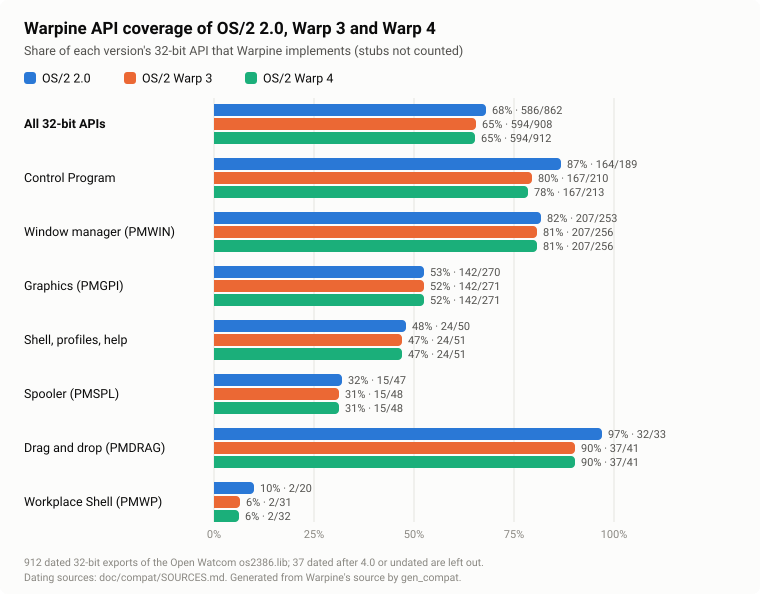
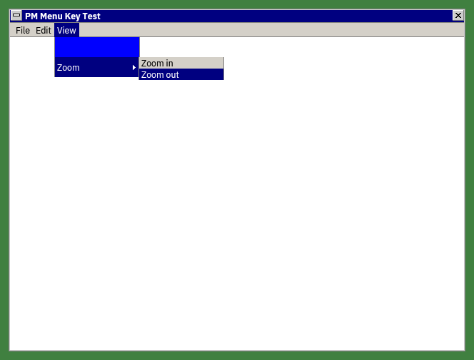
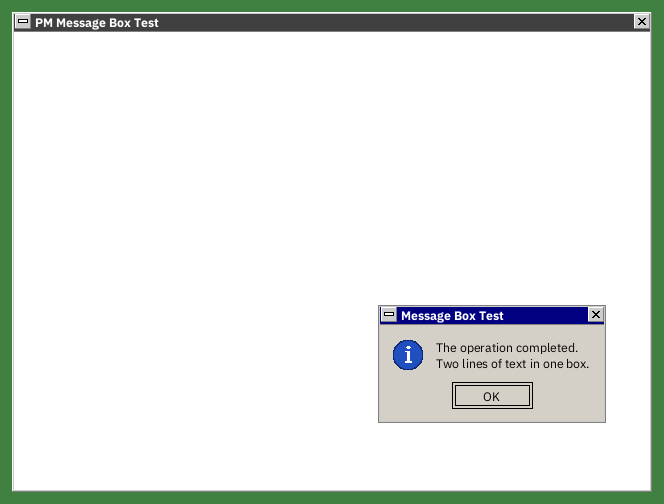
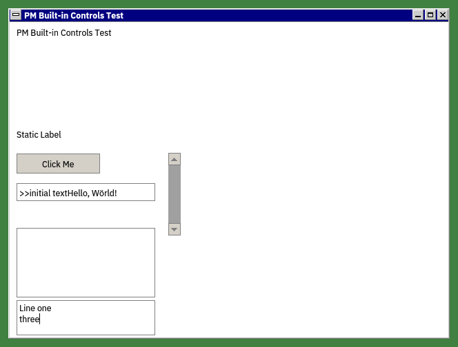
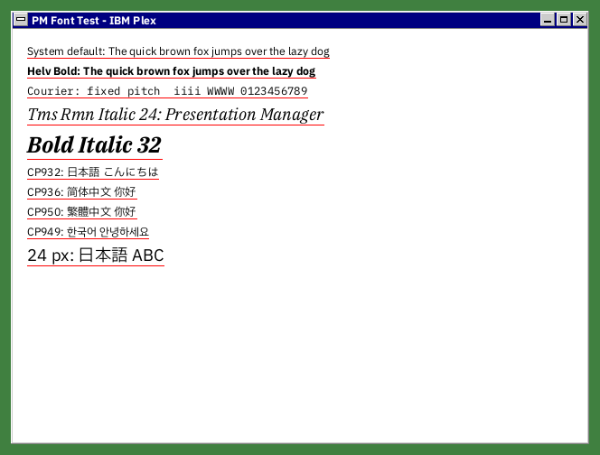

# Warpine: OS/2 Compatibility Layer

<picture>
  <source media="(prefers-color-scheme: dark)" srcset="doc/compat/api_coverage_dark.svg">
  
</picture>

*API coverage, generated from Warpine's source and a public dating of the OS/2 API by `gen_compat` (`cargo run --bin gen_compat -- table` prints it as text; data and sources in [doc/compat](doc/compat/SOURCES.md)).*

> ⚠️ **Experimental — not for production use.** Warpine is a research and hobby project, worked on in spare time at an irregular pace. APIs are incomplete, behaviour may be incorrect, and security has not been hardened. Use at your own risk.

Warpine runs 32-bit OS/2 (LX format) and 16-bit OS/2 1.x (NE format) programs natively on Linux, using KVM hardware virtualization. It works much as WINE does for Windows, but its goal is different.

**The goal: an OS/2-alike API and its runtime environment.**
- **A foundation for Free Software.** Warpine provides a familiar, robust set of OS/2-style APIs (the Control Program, Presentation Manager, VIO, SOM and more) for new Free Software to build on.
- **API-compatible, not a clone.** Programs written to the documented OS/2 APIs run on it, but Warpine doesn't recreate OS/2 itself, and running every existing OS/2 application is not a goal.
- **Source-level compatible where binaries cannot be.** Where no public source gives a DLL's ordinals (the TCP/IP socket DLLs, SOM beyond its first 47 exports), Warpine numbers the documented calls itself: programs rebuilt with Warpine's tools link them by name ([ADR-0123](doc/adr/0123-own-ordinals-where-none-are-public.md)).
- **Legacy applications case by case.** When an existing application matters to people, the work to make it run is done for that application.
- **Free of proprietary material.** Behaviour comes from public documentation and from what test programs observe (near-clean-room). Anything that would need proprietary intellectual property is left out, not worked around.

![Warpine's built-in CMD.EXE in its 80×25 text window: the ver command (Warpine OS/2 Compatibility Layer [Builtin CMD.EXE] version 0.0.6) and a dir listing of the empty drive C:, ending at the [C:\\] prompt](doc/screenshots/cmd.png)

<!-- screenshots:begin -->
## Screenshots

### Working today

| | |
|---|---|
|  |  |
| **Menus from the keyboard, with a cascade.** F10 started menu mode, Left went to *View*, Down dropped its pull-down (an owner-drawn swatch sized with `WM_MEASUREITEM`), Down and Right opened *Zoom*'s cascade beside its row and Down moved to *Zoom out*. The program hears `WM_INITMENU` for each pull-down and cascade, `WM_MENUSELECT` and `WM_MENUEND`. | **Message boxes.** `WinMessageBox` with the information icon over its disabled owner. Without `MB_MOVEABLE` a box has no system menu and stays put; `WinMessageBox2` adds the program's own buttons and icon, and non-modal boxes. |
|  |  |
| **Built-in controls and typing.** The entry field was clicked and typed into (`Hello, Wörld!` at the end, then *Home* and `>>` at the start); in the multi-line field, Enter after "Line one" and `three` started a new line. | **Circular sliders.** `WC_CIRCULARSLIDER` dials turned in a scripted session: Volume (range 0–50, steps of 5) with Right, Page Up, End and its − / + buttons; Heading (`CSS_360`, `CSS_POINTSELECT`) with a press and a drag. The owner hears `CSN_TRACKING`, `CSN_CHANGED` and `CSN_SETFOCUS`. |
|  |  |
| **Container trees and grids.** `WC_CONTAINER` in the tree view with tree lines and expanders (`CA_TREELINE`), and in the icon view arranged on a grid (`CM_SETGRIDINFO`, `CMA_ARRANGEGRID`). Context menus (`WM_CONTEXTMENU`) and the mouse wheel reach containers too. | **Typography.** Presentation Manager text is drawn in the embedded IBM Plex families: fonts chosen with `GpiCreateLogFont` (face, bold, italic, size) and CJK text in four DBCS codepages. The red rules are the widths reported by `GpiQueryTextBox`. |
|  |   |
| **Text-mode programs in a PM window.** Warpine's built-in `CMD.EXE` runs in a frame on the PM desktop, as in an OS/2 window session: `ver`, `mkdir`, an `echo` redirected into a file on drive C:, `dir` and `type`. `WARPINE_VIO=fullscreen` runs it full screen instead (the text window at the top of this page). |   |

### Work in progress

- **Containers and drag and drop** — drags work within a program, between programs and from the host's file manager; lazy drag and owner-painted container backgrounds are missing.
- **Menus** — keyboard menus, menu notifications, item changes and owner-drawn items measured with `WM_MEASUREITEM` and one level of cascading submenus work; deeper cascades are missing.
- **Help** — F1 posts `WM_HELP`, but there is no help viewer yet; the INF / HLP reader is under way (headers and tables of contents, `warpine --inf-toc`; ADR-0132).
- **More GPI** — rounded box corners, line ends and joins, scaled line widths, rotated glyphs and images under transforms, palettes, and drawing through a child window's presentation space are not implemented.
- **Games and video** — DIVE (direct framebuffer blitting) and OpenGL are not implemented yet; the spooler reports no printers.

_The menu and circular-slider screenshots captured from commit `0f27fce` on 2026-11-23, the others from uncommitted changes on top of `848a01b`; the text window at the top from uncommitted changes on top of `8f820e1` on 2026-11-20._
<!-- screenshots:end -->

## Key Features

- **LX Executable Parser:** Full support for LX headers, object tables, page maps, fixups, resource tables, import tables, entry tables, and non-resident names tables.
- **KVM Hypervisor:** Custom VMM executing 32-bit OS/2 code at native speed via hardware-accelerated virtualization.
- **API Thunking:** System call interception via `INT 3` traps bridging guest OS/2 calls to host Rust implementations. Covers DOSCALLS, QUECALLS, PMWIN, PMGPI, KBDCALLS, VIOCALLS, MOUCALLS, NLS, MSG, MDM (MMPM/2), UCONV, SO32DLL, TCP32DLL, PMSHAPI, HELPMGR, PMSPL, PMCTLS, PMDRAG, SOM, REXX / REXXAPI and PMWP's window positions, plus Warpine's own WARPINE.DLL — 1034 entry points in all (`--compat` lists them).
- **DLL Loader Chain:** Runtime dynamic loading via `DosLoadModule` / `DosQueryProcAddr` / `DosQueryModuleHandle`. User DLLs are loaded into guest memory with rebased objects and export maps. Exports are found by ordinal and by name in both names tables, and `_DLL_InitTerm` routines run at start and in `DosLoadModule`.
- **Multi-Threading:** OS/2 threads mapped 1:1 to host threads, each with its own KVM vCPU; ending a thread ends only that thread, `DosWaitThread` / `DosKillThread` / `DosSuspendThread` / `DosResumeThread` follow the Control Program Reference, a thread spinning in its own code can be stopped (each vCPU can be kicked out of the guest), signal exceptions reach thread 1, and vCPUs of ended threads are reused.
- **Presentation Manager (GUI):** Window management, message loop, graphics primitives (drawn on the calling thread, so `GpiQueryPel` reads pixels back and `GpiSetMix` raster operations such as XOR combine with what is there), memory presentation spaces, bitmaps (`GpiCreateBitmap`, `GpiLoadBitmap`) and `GpiBitBlt` with raster operations and stretching, logical colour tables, polylines, regions and clipping, areas, paths, polygons and curves, presentation-space state with save / restore, coordinate transforms and page units, text layout with character angle, shear and direction, `WinDrawText`, update rectangles with `WinScrollWindow` and `WinDrawBorder`, the rectangle helpers, interactive scroll bars, the standard file and font dialogs, the switch list, atom tables and DDE within a program, combination boxes, spin buttons, sliders, value sets, owner-drawn list boxes, menu items and buttons, static icons and bitmaps, presentation parameters (colours and fonts), hooks and message broadcasts, frame controls, accelerator tables made at run time, the text cursor, window lookups (`WinMapWindowPoints`, `WinWindowFromPoint`, `WinEnumDlgItem` …), key state, system colours, timers, clipboard, dialogs, menus, and resource loading via SDL. Each window is kept as its own texture and drawn by the platform's accelerated SDL renderer with vsync, so moving windows costs no redrawing (`WARPINE_COMPOSITOR=software` composites on the CPU instead).
- **One desktop per session:** the PM programs of a session — each its own Warpine process — share one desktop owned by a desktop server process: their windows stack and activate across programs, input reaches them in the order it was typed, and a program can list every window on the desktop, query, send, post and broadcast to, move, minimize, hide and activate another program's windows (`WinBeginEnumWindows`, `WinSendMsg`, `WinBroadcastMsg`, `WinQueryWindowProcess`, `WinSetWindowPos`, …). The programs share the window list (Ctrl+Esc), the switch list and the system atom table, and talk DDE with each other.
- **Frame system menu:** PM frames open their system menu by a click on the icon, Alt+Space or Shift+Esc; choices reach the program as `WM_SYSCOMMAND`, and Move / Size (Alt+F7 / Alt+F8) work from the keyboard. `WinPopupMenu` shows pop-up menus.
- **IBM Plex Typography:** All PM text (title bars, menus, dialogs, controls, and GPI text) is rendered anti-aliased in the embedded IBM Plex Sans / Mono / Serif families, with IBM Plex Sans JP / KR / TC / SC for CJK and GNU Unifont as the last-resort fallback. `GpiCreateLogFont` maps OS/2 face names, bold/italic and size onto these faces; font metrics APIs report their real proportional widths.
- **Text-mode programs in a PM window:** a VIO program runs in a window on the PM desktop, as in an OS/2 window session — CP437 8×16 font, CGA 16-colour palette, blinking cursor. The window can be resized (scroll bars over the screen), minimized, maximized and hidden (the window list, Ctrl+Esc, brings it back); its system menu changes the font size, scrolls and marks with the keyboard, copies text and pastes the clipboard as keystrokes, and the mouse reaches programs through MOUCALLS. `WARPINE_VIO=fullscreen` runs it full screen instead (the only choice for programs marked incompatible with PM windowing), Alt+Home switches between the two while it runs, and `WARPINE_HEADLESS=1` uses the host terminal.
- **Text-Mode Console:** Full VIO and KBD subsystem emulation with screen buffer, cursor management, scroll, and keyboard input; ANSI escape sequences in `VioWrtTTY` / `DosWrite` output (cursor, `cls`, colours), and output redirected to files with `DosDupHandle` (`echo text > file` from a shell).
- **Filesystem:** HPFS-compatible VFS (`VfsBackend` trait) with `HostDirBackend`: case-insensitive lookup, extended attributes (xattrs + sidecar), file locking, OS/2 wildcard matching, sandbox isolation. C: drive auto-mounted at `~/.local/share/warpine/drive_c/`.
- **Memory Management:** `DosAllocMem`/`DosFreeMem`, shared memory between the processes of a session (a program reaches only the blocks it holds, in its code and through API calls), `DosSub*` suballocation (bookkeeping kept by Warpine), guest physical memory manager.
- **IPC and threads:** Event / mutex / muxwait semaphores with their queries, critical sections, DOS timers posting semaphores, exit lists (`DosExitList`), per-thread exception handlers (`DosUnwindException` calling them with `EH_UNWINDING`; NULL pointers trap as on OS/2), anonymous and named pipes (also between Warpine processes), and named message queues.
- **Process Management:** `DosExecPgm` and `WinStartApp` (the child gets its arguments, environment and inheritable pipe handles; a program cannot start Warpine processes more than 8 levels deep or keep more than 16 children, and `THREADS=` in `C:\CONFIG.SYS` bounds the threads of the whole session), DLLs found along `LIBPATH=` and BEGINLIBPATH / ENDLIBPATH, a starting environment from CONFIG.SYS's `SET` statements, `DosWaitChild`, `DosSearchPath`, `DosQueryModuleName`, directory tracking, system information queries.
- **Profiles and help:** `Prf*` profile calls with OS2.INI / OS2SYS.INI on drive C: (in Warpine's own text format), and Help Manager instances so programs with online help start (no help viewer yet).
- **NLS:** `DosQueryCtryInfo`, `DosQueryCp`, `DosMapCase`, `DosGetDateTime` — verified correct.
- **Dates after 2038:** a session clock that `DosSetDateTime` moves (the host clock is never touched) and `WARPINE_CLOCK=2040-03-01` starts anywhere; file times in local time up to the `FDATE` limit 2107, set by `DosSetFileInfo` / `DosSetPathInfo`; `WARPINE.DLL` offers 64-bit time calls (`WrpTime64` …) to programs that can be recompiled.
- **SOM runtime kernel:** `SOM.DLL` is built in: `SOMObject`, `SOMClass` and `SOMClassMgr` with metaclasses, multiple inheritance and the C and C++ bindings; classes loaded from DLLs by name (`somFindClass`); IBM's SOM 1.0 ordinals (from osFree's export list), IBM's `ClassData`, method-table and `CClassData` layouts for the root classes, and `somBuildClass` for classes built from IBM's static class information; dynamic dispatch (`somDispatch`, `somApply`, `somVaBuf_*`) through the apply stubs `somidl` writes ([ADR-0126](doc/adr/0126-som-dynamic-dispatch.md)); TypeCodes (`TypeCodeNew`, `TypeCode_*`, the `TC_*` constants) in Warpine's own layout ([ADR-0128](doc/adr/0128-som-typecodes.md)). IBM's ordinals above 47 and the initializer control blocks are still missing ([ADR-0059](doc/adr/0059-som-runtime-kernel.md) to 0063, 0070 to 0073).
- **Workplace Shell classes (started):** `WPObject` and `M_WPObject` as SOM classes in the SDK's `libwps.a`, built with `somidl`: setup strings, titles, styles, object IDs, save / restore, deletion; `WPAbstract` keeps objects in the user profile, found again by handle or by object ID (`WinQueryObject`); `WinCreateObject` / `WinSetObjectData` / `WinDestroyObject` from any program; `WPFileSystem` / `WPDataFile` / `WPFolder` objects for files and directories, their state in the files' extended attributes, folder contents and new files ([ADR-0130](doc/adr/0130-workplace-objects-created-through-the-profile.md)); programs subclass them in IDL ([ADR-0129](doc/adr/0129-wps-classes-in-the-sdk.md)). Views, icons, menus and a Workplace Shell process are still to come.
- **MMPM/2 Audio:** `DosBeep` plays real sine-wave tones; `mciSendCommand`/`mciSendString` play `waveaudio` WAV files (wait, notify, seek, volume, aliases) through SDL3 audio streams on the main thread.
- **NE Format Execution:** Full NE (New Executable) loader and 16-bit execution — loads OS/2 1.x 16-bit NE binaries into GDT-tiled guest memory, dispatches DOSCALLS/VIOCALLS via Pascal-convention 16-bit thunks. `ne_hello` (pure assembly, no Watcom CRT) runs `DosWrite`+`DosExit` correctly.
- **GDB Remote Stub:** `--gdb <port>` enables GDB RSP over TCP — attach with `gdb`/`gef`/`pwndbg` for software breakpoints, single-step, and full register/memory access. Programs built with `-g` by GCC or clang get a debug companion from `lx-link`, so GDB debugs them at the source level, DLLs included (ADR-0102, ADR-0104).
- **Crash Dump Facility:** Structured crash reports on fatal VMEXITs — registers, stack, code bytes, and last 256 API calls written to `~/.local/state/warpine/warpine-crash-<pid>.txt` (`$XDG_STATE_HOME/warpine`).
- **Ring 3 (ADR-0113):** programs run at ring 3, as on OS/2, 32-bit and 16-bit alike: privileged instructions raise `XCPT_PRIVILEGED_INSTRUCTION`, and the processor keeps programs out of their page tables, their TSS and Warpine's descriptor tables (supervisor-only pages), and the API thunks are read-only. Each thread has its own TSS and ring-0 stack, and no API call writes Warpine's protected memory for a program.
- **A cgroup per session:** a session's processes share a systemd scope with a memory and a task limit (ADR-0116; 8 GB and 8192 tasks by default, `WARPINE_SESSION_MEMORY_MAX` / `WARPINE_SESSION_TASKS_MAX`, `WARPINE_CGROUP=off`), so one program cannot take the machine's memory or tasks.
- **No-execute memory:** a program's stack, heap and data cannot run as code (PAE paging with the execute-disable bit, ADR-0131); only its code objects and memory it allocates with `PAG_EXECUTE` can. `WARPINE_NX=off` turns it off for a legacy program that runs code from its data.
- **Landlock sandbox:** every Warpine process confines its own file access (ADR-0111): the drives and the session read-write, the system's files read-only, the rest of the home directory out of reach. `WARPINE_SANDBOX=off` turns it off; `warpine --sandbox-check <path>` shows whether a path is reachable.
- **System-call filter:** behind Landlock, a seccomp filter per process role (ADR-0124) refuses debugging other processes, new namespaces, `bpf` / `io_uring` / `userfaultfd` and similar kernel interfaces, administration calls and typing into the terminal; the desktop server cannot start programs or use KVM. `WARPINE_SANDBOX=off` turns it off too; `warpine --syscall-check guest|desktop-server` reports it.
- **Builtin CMD.EXE Shell:** Native Rust command shell. `cargo run -- CMD.EXE` opens it in a window on the PM desktop (same as any CLI app); `WARPINE_HEADLESS=1` falls back to the host terminal. Also intercepts `DosExecPgm("CMD.EXE")` from running OS/2 guests. No Open Watcom required. It follows OS/2's CMD syntax: `%name%` variables, `&` / `&&` / `||` on return codes, `^` escapes, pipes and `<` / `>` / `>>` (inside the drives) that OS/2 programs read and write too, and a `PATH` search; programs start in the shell's directory. Built-in commands: `DIR`, `CD`, `SET`, `PATH`, `PROMPT` (OS/2's `$` codes, ANSI colours), `ECHO`, `CLS`, `VER`, `TYPE`, `MD`, `RD`, `DEL`, `COPY`, `REN`, `MOVE`, `START`, `DETACH`, `HELP`, `EXIT`; commands group with `( … )`, and the programs of a pipeline run at the same time. Line editor with history (↑/↓). `.CMD` scripts in REXX (a first line starting with `/*`; Warpine's own interpreter: the language, conditions, streams on the drives, TRACE and common REXXUTIL functions; OS/2 programs embed it through `RexxStart` and the REXX API) or with OS/2's batch control: `ECHO ON` / `OFF` and `@`, `%0`–`%9` and `SHIFT`, `IF`, `FOR`, `GOTO`, `CALL`, `SETLOCAL` / `ENDLOCAL`, `PAUSE`.
- **Rust Guest Toolchain (Phase C):** Write OS/2 guest applications in Rust with `no_std`. Three standalone crates: `crates/warpine-os2-sys` (raw API bindings for DOSCALLS/VIOCALLS/KBDCALLS), `crates/warpine-os2-rt` (`_start` + panic handler + global allocator via `DosAllocMem`/`DosFreeMem`), `crates/warpine-os2` (ergonomic wrappers: `mod file`, `mod memory`, `mod thread`, `mod vio`, `mod process`). `samples/rust_hello` demonstrates a full Rust→LX binary with `cargo build` on the pinned nightly.
- **C and C++ from GCC and clang:** `os2.h` and the PM headers, a small C runtime, a C++ runtime with exceptions and RTTI, the `os2rc` resource compiler, the `os2msg` message compiler, `somidl`, a SOM IDL compiler writing C and C++ bindings (Open Watcom's SOM samples build from them), and `lx-link` making programs and DLLs from ELF objects, with resources and bound messages (ADR-0095–0105). Every C sample builds with either compiler, also pinned ones from a Podman image, and the integration tests pass with those builds as with Open Watcom's.
- **API Compatibility Report:** `warpine --compat` prints a module-grouped report of all implemented APIs with stub annotations.

## Architecture

[](doc/architecture/warpine.svg)

The diagram is generated from [`doc/architecture/layers.toml`](doc/architecture/layers.toml) and the module list of `src/` by `cargo run --bin gen_arch -- render`; a test keeps the two in step ([ADR-0021](doc/adr/0021-generated-architecture-diagram.md)).

```
src/
  main.rs              Entry point, format detection (LX/NE), CLI/PM/SDL dispatch
  lx/                  LX executable format parser (header, entry table, non-resident names)
  ne/                  NE (16-bit) executable format parser
  gui/                 SDL backends: PmRenderer, SdlRenderer, HeadlessRenderer,
                         SdlTextRenderer, HeadlessTextRenderer, run_pm_loop, run_text_loop
  loader/
    mod.rs             Loader, SharedState (all managers + DllManager), KVM setup
    vcpu.rs            vCPU thread: VMEXIT loop, GDB integration, crash dump hooks
    vm_backend.rs      VmBackend/VcpuBackend traits (KVM + mock implementations)
    kvm_backend.rs     KVM-based VmBackend implementation
    guest_mem.rs       GuestMemory: safe typed read/write into KVM guest memory
    lx_loader.rs       LX/DLL loading: load(), load_dll(), find_dll_path(), apply_fixups()
    ne_exec.rs         NE executable loader: load_ne(), setup_guest_ne(), handle_ne_api_call(), ne_api_arg_bytes()
    descriptors.rs     GDT/IDT setup, resolve_import() (built-ins + DllManager)
    constants.rs       Named constants: MAGIC_API_BASE, ordinal bases, TIB/PIB addresses
    api_registry.rs    Static sorted API thunk table (596 entries); compat_report()
    api_dispatch.rs    Ordinal → handler dispatch + sub-dispatcher routing
    api_trace.rs       ordinal_to_name(), module_for_ordinal() for structured tracing
    api_ring.rs        256-entry API call ring buffer for crash post-mortem
    crash_dump.rs      Structured crash reports on fatal VMEXITs
    gdb_stub.rs        GDB Remote Stub: RSP over TCP, breakpoints, single-step
    doscalls.rs        DOSCALLS API implementations
    viocalls.rs        VIOCALLS (Video I/O) implementations
    kbdcalls.rs        KBDCALLS (Keyboard) implementations
    pm_win.rs          PMWIN (Window Manager) implementations
    pm_gpi.rs          PMGPI (Graphics) implementations
    pm_types.rs        PM data types (windows, classes, WindowManager)
    pm_edit.rs         Edit-buffer logic for PM text controls
    pm_controls.rs     Interactive entry field, MLE and list box controls
    mmpm.rs            MMPM/2 audio: MmpmManager, beep_tone, mciSendCommand/String
    console.rs         VioManager: screen buffer, cursor, raw/SDL mode, ANSI output
    process.rs         Process execution and directory tracking
    managers.rs        MemoryManager, HandleManager, DllManager, LoadedDll, and more
    stubs.rs           DosLoadModule, DosQueryProcAddr, and other API implementations
    ipc.rs             Semaphores, pipes, and queues
    vfs.rs             VfsBackend trait, DriveManager, OS/2 filesystem types
    vfs_hostdir.rs     HostDirBackend: HPFS-on-host-directory implementation
    locale.rs          Os2Locale: country/codepage information
    mutex_ext.rs       MutexExt trait (poison-recovering lock)
samples/               OS/2 sample applications and build scripts
  hello/               DosWrite "Hello" — basic smoke test
  alloc_test/          DosAllocMem/DosFreeMem round-trip
  pm_demo/             Presentation Manager GUI demo
  pm_hello/            Minimal PM "Hello World" window
  pm_bench/            PM self-benchmark: GPI, message, paint and timer rates
  pm_pel_test/         GPI read-back (GpiQueryPel) and mix modes (XOR, invert…)
  pm_bitmap_test/      Memory PS + bitmaps, GpiBitBlt, GpiLoadBitmap / WinDrawBitmap, colour tables
  pm_audio_test/       DosBeep and MMPM/2 waveaudio (mciSendString / mciSendCommand)
  shapes/              PM graphics: boxes, lines, arcs
  thread_test/         DosCreateThread/DosWaitThread
  thread_exit_test/    DosExit(EXIT_THREAD), DosWaitThread, the last thread ending the process
  xcpt_thread_test/    Per-thread exception-handler chains, DosRaiseException
  xcpt_unwind_test/    DosUnwindException, longjmp out of a trap handler, NULL-pointer traps
  wcxx_throw_test/     Open Watcom C++ exceptions running destructors (through DosUnwindException)
  exitlist_test/       DosExitList in the four ways a process ends
  semquery_test/       Semaphore queries, muxwait lists and their error codes
  kernel2_test/        Critical sections, DOS timers, DosSearchPath, DosQueryModuleName, suballocation
  thread_control_test/ Suspend / resume, stopping a spinning thread, signal exceptions
  pipe_test/           DosCreatePipe/DosWrite/DosRead
  npipe_test/          Named pipes, inherited pipes, a child's arguments and environment
  mutex_test/          DosCreateMutexSem recursive locking
  muxwait_test/        DosCreateMuxWaitSem multi-semaphore wait
  queue_test/          DosCreateQueue/DosWriteQueue/DosReadQueue
  ipc_test/            Combined IPC exerciser (semaphores + pipes)
  thunk_test/          TIB/PIB layout, DosGetInfoBlocks, DosQuerySysInfo
  nls_test/            DosQueryCtryInfo, DosQueryCp, DosMapCase, DosQueryDBCSEnv, DosQueryCollate
  file_test/           DosOpen/Read/Write/Close file I/O
  dir_test/            DosCreateDir/DeleteDir/FindFirst directory ops
  find_test/           DosFindFirst/Next wildcard search
  findbuf_test/        DosFindFirst multi-entry buffer packing
  fs_ops_test/         Filesystem operations (move, delete, attribs)
  vfs_test/            VFS subsystem integration test
  screen_test/         VIO screen buffer and cursor operations
  ne_hello/            NE (16-bit) format hello world
  dbcs_test/           DBCS VIO cell classification and lead-byte query
  uconv_test/          UCONV.DLL Unicode conversion round-trip
  audio_test/          MMPM/2 audio: DosBeep and mciSendString
  pm_controls_test/    PM built-in controls (WC_BUTTON, WC_STATIC, WC_ENTRYFIELD, etc.)
  pm_menu_dlg_test/    PM menu bar, pull-down menu and modal dialog from resources
  pm_list_test/        List box selection modes, LN_ENTER and MLE word wrap
  pm_msgbox_test/      WinMessageBox as a modal PM dialog: icons, Help, answered by keys and clicks
  pm_button_test/      Check boxes and radio buttons: BM_SETCHECK, auto styles, arrow keys
  pm_minmax_test/      Frame minimize / maximize / restore, WM_MINMAXFRAME, system keys
  pm_destroy_test/     WinDestroyWindow and the order of WM_DESTROY
  pm_error_test/       WinGetLastError and PMERR_* codes per thread
  pm_pointer_test/     Mouse pointers: system pointers, WinSetPointer, WinLoadPointer
  pm_window_test/      WinSetParent, WinSetOwner, WinIsWindowVisible, WinQueryWindowPtr
  mou_test/            MOUCALLS mouse events in a VIO window and full screen
  ansi_test/           ANSI escape sequences in VioWrtTTY and DosWrite output
  pm_sysmenu_test/     PM frame system menu, Alt+F7 / Alt+F8, WinPopupMenu
  pm_rect_text_test/   Rectangle helpers, WinDrawText, GpiPolyLine
  pm_scroll_test/      Scroll bars and the PM text cursor
  pm_profile_test/     PMSHAPI profiles (OS2.INI) and HELPMGR help instances
  pm_paint_test/       Update rectangles, WinScrollWindow, WinDrawBorder
  pm_region_test/      GPI regions, clipping, areas, paths, polygons and curves
  pm_combo_spin_test/  Combination boxes, spin buttons and owner drawing
  pm_msg_hook_test/    PM hooks, WinBroadcastMsg and the other messaging calls
  pm_frame_accel_test/ Frame controls, accelerator tables, WinLoadMessage and other window calls
  pm_presparam_test/   Presentation parameters, static styles, class styles and WinLockWindowUpdate
  pm_slider_valueset_test/ Sliders and value sets
  pm_textpos_test/     GPI text layout, rotated, sheared and vertical text
  pm_xform_test/       GPI state, transforms and page units
  pm_stddlg_test/      Standard file and font dialogs, printing stubs
  pm_switch_dde_test/  WinStartApp, switch list, atom tables, DDE, MSG calls
  nest_test/           A program that starts itself, stopped at the nesting limit
  nx_test/             Execute protection: code on the stack, in data, in memory without PAG_EXECUTE traps
  threads_limit_test/  CONFIG.SYS THREADS= bounds threads and child processes of a session
  argv_test/           argc / argv / environment and session-unique process ids across children
  kill_test/           DosKillProcess, exit lists on kill, interrupted waits, Ctrl+C and Ctrl+Break as signals
  pm_dlg_signal_test/  Signals reaching a program waiting in a modal dialog
  npipe_cut_test/      Pipe writes interrupted mid-message by DosKillThread and signals, the message kept whole
  datetime_test/       Dates after 2038: session clock, DosSetDateTime, file times, WARPINE.DLL
  infoseg_test/        DosGetInfoSeg global and local information segments, a running clock
  fileattr_test/       FILE_READONLY by path, handle and DosSetFileMode; read-only files not deletable
  bigdata_test/        1.5 MB of static data, all of it the program's own
  largefile_test/      Files past 4 GB: DosOpenL, DosSetFilePtrL, DosSetFileSizeL, FILELOCKL, 64-bit sizes
  ea_test/             Extended attributes by handle and path: set, sized, queried, enumerated
  attr_test/           Hidden, system and archive kept and reported, archive on write, carried by DosCopy
  libpath_test/        CONFIG.SYS LIBPATH and SET: the DLL search order and the starting environment
  pm_child_dialog_test/ A dialog embedded in a client window (WinLoadDlg with the client as parent)
  pm_embdlg_test/      An embedded dialog's title bar and border, Tab across its edge, the pointer reaching its own windows
  pm_notebook_test/    WC_NOTEBOOK: pages, major / minor tabs, notifications, embedded page dialogs
  pm_notebook_dlg_test/ A tabbed-dialog notebook: page dialogs, refused turns, buttons, scrolling tabs, Tab
  pm_container_test/   WC_CONTAINER: records in guest memory, detail view, selection, CN_* notifications
  pm_cnrtree_test/     WC_CONTAINER: sorting by a guest comparison function, tree view, scroll bar
  pm_cnricon_test/     WC_CONTAINER: icon view and icons, filtering, direct editing
  pm_cnrdetail_test/   WC_CONTAINER: split details view, horizontal scrolling, owner drawing, title edits
  pm_cnrgrid_test/     WC_CONTAINER: tree lines and moves, grid arrangement, stacking, context menus, the wheel
  pm_subclass_test/    Subclassing built-in windows and frames, painting, dialog mnemonics
  shmem_test/          Shared memory between a parent and a child process
  shsem_test/          Shared semaphores between a parent and a child process
  pm_drag_test/        Drag and drop within a process: DrgDrag, DM_* messages, container drags
  pm_dropfiles_test/   Host files dropped on a window, DrgDragFiles, Ctrl / Shift drag operations, WM_ENDDRAG
  semfollow_test/      Semaphore and pipe-semaphore follow-ups, suballocation
  pm_frame_scroll_test/ Frame scroll bars with the mouse, client drawing inside the frame
  pm_charbundle_test/  GpiSetAttrs / GpiQueryAttrs character bundle
  pm_modal_filter_test/ Message-filter hooks in modal loops, standard-dialog notifications
  pm_query_test/       Window lookups, key state, message position, system colours
  pm_typeahead_test/   Keys typed while the program is busy reach the focus window of the moment they are read
  pm_inputorder_test/  Clicks are hit-tested and activate their frame when read, after the input before them
  pm_twoproc_test/     Two PM programs on one desktop, with input in order across them
  pm_xproc_test/       Calls on another program's windows through the desktop server
  pm_xshell_test/      The session's switch list, window list, system atoms and DDE between programs
  pm_xdrag_test/       Drag and drop between programs: DM_* messages, DRAGINFO and DM_RENDER across them
  pm_paint_input_test/ Update regions, clicks to the deepest window, WM_HITTEST, WinQueryQueueStatus, must-complete sections
  som_build_test/      somBuildClass: classes from static class information, in the program and in a DLL
  som_layout_test/     IBM's SOM layouts: ClassData release order, somMethodTab header, parentMtab
  som_ordinal_test/    SOM.DLL imported by IBM's ordinals 1–47 (osFree's list): data, NewClass, ids, printing
  som_test/            Open Watcom's SOM samples (helloc, classes, animals, hellocpp) on Warpine's SOM runtime, with hand-written C and C++ bindings, and class loading and unloading by name
  dllinit_test/        DLL initialization at start and in DosLoadModule, OS/2 module paths
  dll_noinit/          A DLL with exports and no initialization routine (loader unit tests)
  cmd_tool/            A probe for the built-in CMD.EXE: exit codes, standard input, the current directory
  cmd_scripts/         .CMD scripts the built-in CMD.EXE's tests run
  pm_font_test/        GPI font selection (IBM Plex families, styles, sizes) and CJK text
  pm_shapes_test/      GPI arcs, area patterns and line widths, checked with GpiQueryPel
  pm_codepage_test/    Queue and presentation-space codepages (WinSetCp, CP1004, GpiSetCp)
  pm_dialog_test/      Keyboard-driven dialog: accelerators, Tab, arrows, mnemonics, clipboard
  socket_test/         TCP/IP sockets over loopback (SO32DLL via DosLoadModule)
  cmd_test/            test.cmd: built-in CMD.EXE commands, redirection and pipes
  rust_hello/          Rust guest binary: "Hello from Rust on Warpine!" (Phase C)
  c_hello/             A C program from GCC or clang, linked by lx-link
  c_sdk_test/          A C program built with the SDK (os2.h and the C runtime) by GCC or clang
  c_pm_test/           A PM program built with the SDK's pm.h by GCC or clang
  c_gdb_test/          A C program built with -g, for source-level debugging with GDB
  cxx_test/            A C++ program (exceptions, RTTI, new / delete) built by g++ or clang++
  build_sdk.sh         Builds every C sample with GCC or clang into samples/build/
sdk/                   The SDK for GCC and clang: os2.h, a small C runtime, a C++ runtime, os2.mk (os2rc compiles resources, os2msg messages)
vendor/setup_compilers.sh  Pinned GCC and clang in a Podman image (vendor/pinned/ runs them)
vendor/setup_ci_image.sh   The CI image: the same pinned base, SDL3, GDB and Rust (ADR-0106)
ci/                    The CI matrix (matrix.sh) and its local runner (run.sh); .github/workflows/ci.yml calls them
tests/rc/              Resource scripts os2rc must compile exactly as Open Watcom's wrc does
crates/                Standalone guest crates (NOT part of the host workspace)
  warpine-os2-sys/     Raw #![no_std] OS/2 API bindings (extern "C" declarations)
  warpine-os2-rt/      Runtime: _start entry, panic handler, global allocator
  warpine-os2/         High-level wrappers: file::write_stdout, process::exit
```

See [doc/developer_guide.md](doc/developer_guide.md) for detailed internals documentation, [doc/reference_manual.md](doc/reference_manual.md) for the user reference manual, [doc/adr/](doc/adr/README.md) for the architecture decision records — why Warpine is built the way it is — and [doc/glossary.md](doc/glossary.md) for the OS/2 and Warpine terms they use.

## Prerequisites

- **CPU:** x86_64 with virtualization support (VT-x or AMD-V enabled).
- **OS:** Linux with KVM support (`/dev/kvm` must be accessible by the user).
- **Toolchain:** Rust 1.100.0 (Edition 2024), pinned in `rust-toolchain.toml`; `rustup` installs it automatically on the first `cargo` invocation.
- **Library:** `libsdl3-dev` — SDL 3, found through pkg-config (for the PM desktop, the VGA text window and audio).
- **Optional (for samples):** Open Watcom v2 — `./vendor/setup_watcom.sh` to vendor it (a pinned, dated snapshot whose SHA-256 the script checks before extracting). Snapshots built before 2026-08-11 lose `argv` and the environment of every OS/2 program (Open Watcom #1649); `./vendor/setup_watcom.sh --refresh` replaces such a snapshot, then rebuild the samples.

## Contributing

### Git Hooks

This repo ships a pre-commit hook that runs `cargo test`, `cargo clippy --all-targets -- -D warnings` (the test code is linted too) and, when `cargo-deny` is installed, the dependency policy of `deny.toml` (crates.io sources only, allowed licences, no banned crates) before every commit; releases also run `cargo audit` and `cargo deny check` (ADR-0066). Activate it once after cloning:

```bash
git config core.hooksPath githooks
```

The hook will abort the commit if any test fails or if there are clippy warnings. Where a user systemd instance is available it runs both inside a transient `systemd-run --user --scope` with hard caps (`MemoryMax` 24G, no swap, `TasksMax` 4096; override with `WARPINE_TEST_MEMORY_MAX` / `WARPINE_TEST_TASKS_MAX`), so a runaway test — for example a program that keeps starting Warpine processes — is stopped inside that scope instead of exhausting the machine. To run the tests by hand with the same caps:

```bash
systemd-run --user --scope -p MemoryMax=24G -p MemorySwapMax=0 -p TasksMax=4096 -- cargo test
```

## Getting Started

### 1. Build Warpine
```bash
cargo build
```

### 2. Build sample OS/2 applications
```bash
./vendor/setup_watcom.sh              # Download Open Watcom compiler (once; --refresh replaces an old snapshot)
make -C samples                       # All Open Watcom samples (what the integration tests run)
make -C samples/hello                 # Simple "Hello, OS/2!" CLI app
make -C samples/alloc_test            # Memory allocation test
make -C samples/pm_demo               # Presentation Manager GUI demo
```

### 3. Run an OS/2 binary
```bash
cargo run -- samples/hello/hello.exe        # CLI app (in a window on the PM desktop)
WARPINE_VIO=fullscreen cargo run -- samples/hello/hello.exe   # CLI app in the 640×400 text window
cargo run -- samples/pm_demo/pm_demo.exe    # GUI app

WARPINE_HEADLESS=1 cargo run -- samples/hello/hello.exe   # Terminal fallback
WARPINE_CODEPAGE=437 cargo run -- samples/hello/hello.exe  # Start in CP437 whatever the host locale
```

### 4. Run the builtin CMD.EXE shell
```bash
cargo run -- CMD.EXE                       # Interactive shell (in a window on the PM desktop)
WARPINE_HEADLESS=1 cargo run -- CMD.EXE   # Terminal/headless mode
cargo run -- CMD.EXE /C "ECHO Hello!"     # Run one command and exit
cargo run -- CMD.EXE /K "VER"             # Run one command then stay interactive
```

### 5. Run a VIO sample in a window
```bash
make -C samples/screen_test && cargo run -- samples/screen_test/screen_test.exe
```

### 6. Build and run a Rust guest binary
```bash
# Install nightly + rust-src (once):
rustup toolchain install nightly-2026-11-15 --component rust-src  # the dated nightly the guest crates pin

# Build and install the ELF-to-LX linker (once):
cargo build --bin lx_link && cp target/debug/lx_link ~/.cargo/bin/lx-link

# Build the sample Rust guest:
cd samples/rust_hello
cargo build \
  -Z build-std=core,alloc \
  -Z build-std-features=compiler-builtins-mem \
  -Z json-target-spec \
  --target ../../targets/i686-warpine-os2.json
cd ../..

# Run it:
cargo run -- samples/rust_hello/target/i686-warpine-os2/debug/rust_hello.exe
```

A C program builds the same way with an unmodified GCC or clang (ADR-0095): freestanding i386 ELF objects, linked by `lx-link`.
```bash
cargo build --bin lx_link
make -C samples/c_hello            # GCC; or: make -C samples/c_hello CC=clang
cargo run -- samples/c_hello/c_hello.exe
```

With the SDK (ADR-0096), a C program includes `<os2.h>` and the usual C headers, and links with the SDK's start-up code and runtime; `sdk/os2.mk` gives its Makefile the flags:
```bash
make -C samples/c_sdk_test         # builds sdk/build/gcc/ first; or CC=clang
cargo run -- samples/c_sdk_test/c_sdk_test.exe alpha '"beta gamma"'
cargo build --bin os2rc            # the resource compiler (ADR-0099)
cargo build --bin os2msg           # the message compiler (ADR-0105)
cargo build --bin somidl           # the SOM IDL compiler: C bindings (ADR-0122)
make -C samples/c_pm_test          # a PM program with a menu, a dialog and strings from c_pm_test.rc
cargo run -- samples/c_pm_test/c_pm_test.exe
```

Every C sample builds with either compiler (ADR-0101), and the integration tests can run those builds instead of Open Watcom's:
```bash
samples/build_sdk.sh gcc           # or clang: samples/build/<cc>/<sample>/
WARPINE_SAMPLES=gcc cargo test --test integration
./vendor/setup_compilers.sh        # pinned GCC and clang in a Podman image, by digest and snapshot date
CC_CMD=vendor/pinned/gcc OUT_TAG=gcc-pinned samples/build_sdk.sh gcc
ci/run.sh gcc                      # a CI matrix entry (watcom, gcc, clang) in the pinned image (ADR-0106)
CI_IMAGE_PULL=1 ci/run.sh gcc      # the same in the published image, pulled by the digest ci/image.digest pins
```

C++ works too, with exceptions and RTTI (ADR-0103): `os2.mk` gives `OS2_CXX` and `OS2_CXXFLAGS`, and a program links `libos2cxx.a` before `libos2c.a`. Exceptions pass between a program and its DLLs (ADR-0107), and an OS/2 exception handler may `throw`, so a trap unwinds the frames that trapped and runs their destructors (ADR-0110).
```bash
make -C samples/cxx_test           # g++; or CC=clang for clang++
cargo run -- samples/cxx_test/cxx_test.exe
```

### 7. API compatibility report
```bash
cargo run -- --compat
cargo run -- --licenses   # Warpine's licence and the built-in fonts' notices
```

### 8. Tracing

`RUST_LOG` controls log verbosity. `WARPINE_TRACE` controls output format:

```bash
RUST_LOG=debug cargo run -- samples/hello/hello.exe
WARPINE_TRACE=strace RUST_LOG=debug cargo run -- samples/hello/hello.exe  # strace-like
WARPINE_TRACE=json   RUST_LOG=debug cargo run -- samples/hello/hello.exe  # JSON lines
```

### 9. GDB debugging
```bash
cargo run -- --gdb 1234 samples/hello/hello.exe   # Start with GDB stub on port 1234
# In another terminal:
gdb -ex 'target remote :1234'                      # Attach with GDB
# A program built with -g by GCC or clang has a debug companion beside it
# (ADR-0102), which gives GDB its source lines, types and variables:
make -C samples/c_gdb_test && cargo run -- --gdb 1234 samples/c_gdb_test/c_gdb_test.exe
gdb -ex 'symbol-file samples/c_gdb_test/c_gdb_test.dbg' -ex 'target remote :1234' -ex 'break add_points'
# The DLLs' companions (gdbdll.dbg, gdbdyn.dbg) come from the stub (ADR-0104):
# `break scale_point` works too (with GDB 16, run `sharedlibrary` after connecting).
```

### 10. Run tests and lint
```bash
cargo test                        # 2515 unit tests (no KVM required)
cargo test --test integration     # 239 end-to-end tests (requires /dev/kvm)
cargo clippy --all-targets -- -D warnings  # Lint, test code included — must pass with zero warnings
```

## Status

| Phase | Description | Status |
|-------|-------------|--------|
| 1 | Foundation — LX parser, KVM loader, basic API thunks | ✅ Complete |
| 2 | Core Subsystem — memory, filesystem, threading, IPC, process management | ✅ Complete |
| 3 | Presentation Manager — window management, graphics, input, timers, SDL | ✅ Complete |
| 3.5 | Text-Mode Application Support — VIO/KBD console, command shell | ✅ Complete |
| 4 | HPFS-Compatible VFS — VfsBackend, HostDirBackend, EA, file locking | ✅ Complete |
| 4.5 | 16-bit Thunk Fix — VIO/KBD/MOU calls as direct 32-bit imports instead of 16-bit thunks | ✅ Complete |
| 5 | Multimedia & 16-bit — MMPM/2 audio baseline; NE parser + full 16-bit NE execution | ✅ Complete |
| 6 | SDL VGA Text Renderer — 640×400 CP437 window, CGA palette, blinking cursor | ✅ Complete |
| 7 | Application Compatibility — DLL loader chain (`DosLoadModule`, DLL initialization), case by case | 🔄 In progress |
| 8 | SOM / Workplace Shell — the SOM kernel runs Open Watcom's SOM samples and builds IBM-style classes; the WPS is not started | 🔄 In progress |
| 9 | XE — 64-bit OS/2-lineage platform (new format + API set + Rust toolchain) | 🔮 Far future |

See [doc/TODOs.md](doc/TODOs.md) for the detailed roadmap and [doc/unverified.md](doc/unverified.md) for behaviour still to be checked against OS/2.

## License

This project is licensed under the GNU General Public License, version 3 or (at your option) any later version (GPL-3.0-or-later). See the [LICENSE](LICENSE) file for details. Third-party material under `vendor/` keeps its own licence: IBM Plex (SIL Open Font License 1.1) and GNU Unifont (GPL-2.0-or-later with the font embedding exception, or OFL 1.1).

Bundled third-party fonts keep their own licences: the IBM Plex families in [`vendor/ibm-plex`](vendor/ibm-plex) are © IBM Corp. under the SIL Open Font License 1.1 ([`LICENSE.txt`](vendor/ibm-plex/LICENSE.txt)), and GNU Unifont in `vendor/unifont` is dual-licensed under GPL-2.0-or-later with the GNU font embedding exception ([`LICENSE.txt`](vendor/unifont/LICENSE.txt)) and the SIL Open Font License 1.1 ([`OFL-1.1.txt`](vendor/unifont/OFL-1.1.txt)). Both are built into the `warpine` binary, and `warpine --licenses` prints their notices and licences.

The guest crates in `crates/` are under the GPL too (version 3 or later), so OS/2 programs built with them are covered by the GPL ([ADR-0076](doc/adr/0076-guest-crates-stay-gpl-and-the-binary-carries-its-font-notices.md)).

## Trademarks

Warpine is an independent Free Software project. It is not affiliated with, endorsed by or sponsored by IBM, Microsoft, the Open Watcom project, the WINE project or any other company or project named here.

IBM, OS/2, Presentation Manager, Workplace Shell and IBM Plex are trademarks or registered trademarks of International Business Machines Corporation. Linux® is the registered trademark of Linus Torvalds. Windows is a trademark of the Microsoft group of companies. Other names are trademarks of their respective owners.

These names are used only to describe what Warpine is compatible with or built from. Warpine does not use IBM's logos or branding.


Warpine follows a near-clean-room policy: API behaviour is derived from public documentation and from the observable behaviour of applications built with Open Watcom, never from IBM binaries or their disassembly. These are the sources the project draws on.

### Documentation

- [IBM OS/2 Toolkit Documentation](https://www.edm2.com/index.php/IBM_OS/2_Toolkit_Documentation) (EDM/2) — the *Control Program*, *Presentation Manager* and *Graphics Programming Interface* programming guides and references; the primary description of API semantics.
- [IBM OS/2 Device Driver Development Kit](https://www.edm2.com/index.php/IBM_OS/2_Device_Driver_Development_Kit) (EDM/2) — lower-level system and driver documentation.
- [List of OS/2 Software Development Related Books](https://www.edm2.com/index.php/List_of_OS/2_Software_Development_Related_Books) (EDM/2) — index of further published material.
- [Open Watcom](https://github.com/open-watcom/open-watcom-v2) — the OS/2 headers and import libraries are the source of the ordinal table in [`doc/os2_ordinals.md`](doc/os2_ordinals.md), and its compiler builds the sample programs used as the test oracle.
- [IBM OS/2 Developer's Toolkit 4.5](https://github.com/bitwiseworks/os2tk45) (an unofficial copy of IBM's Toolkit) — its SOM headers (`somobj.idl`, `somcls.idl`, `somcm.idl`, `somapi.h`, `somcdev.h`) are the source of the SOM root classes' layouts ([ADR-0072](doc/adr/0072-som-root-class-layouts-from-the-toolkit.md)). They are only read, at a pinned commit; nothing from the Toolkit is copied, built or run.
- [IBM OS/2 Warp 4 Toolkit Documents 1](https://archive.org/details/ToolkitDocs1) (Internet Archive, reprinted with IBM's permission for OS2World and EDM/2) — the *System Object Model Programming Guide* and *Reference* and the *Workplace Shell Programming Guide* and *Reference*: the OS/2 descriptions of SOM and the Workplace Shell classes.
- [SOMobjects Developer's Toolkit Books, Version 3.0](https://archive.org/details/SOMobjectsDevelopersToolkitBooks/) (Internet Archive) — IBM's SOMobjects 3.0 *Programmer's Guide* and *Programmer's Reference* volumes (1996): SOM's concepts, initializers and the kernel at version 3.0.
- [OS/390 V2R10 SOMobjects library](https://web.archive.org/web/20140106003410/http://www-03.ibm.com/systems/z/os/zos/library/bkserv/os390_r10pdf/#som) (Internet Archive's copy of IBM's page) — *SOMobjects Programmer's Reference, Volume 1* (SC28-1997) and *Messages, Codes and Diagnosis* (SC28-1996): the SOM kernel as IBM documented it for OS/390.
- [OS/2 manuals on bitsavers](https://bitsavers.org/pdf/ibm/pc/os2/) — IBM's OS/2 2.0 Technical Library (1992: *Control Program*, *Presentation Manager* and *Procedures Language 2/REXX* references), the Warp 3 *PM Programming Reference*, the *OS/2 Debugging Handbook* Redbooks, and the 1.1 / 1.2 *MS OS/2 Programmer's Reference*: the dates of the API compatibility chart ([`doc/compat/SOURCES.md`](doc/compat/SOURCES.md), [ADR-0033](doc/adr/0033-generated-compatibility-chart.md)).
- [IBM Toolkit 4.5 books on os2.kr](https://www.os2.kr/komh/os2books/os2tk45/) — the Toolkit 4.5 references as HTML (Control Program, PM, GPI, Workplace Shell, Unicode, Multimedia, TCP/IP, REXX, SOM): the Warp 4 dates of the chart.
- [OS/2 2.0 *System Object Model Guide and Reference*](https://archive.org/details/os2-2.0-som-1991) (Internet Archive, 1991) and the [*SOMobjects Base Toolkit Quick Reference*](https://archive.org/details/manualzz-id-40748) (Bull's AIX edition of IBM's SOM 2.0 reference) — the chart's SOM 1.0 and 2.0 kernel lists.
- [The Config.sys Documentation Project](https://www.edm2.com/index.php?title=CONFIG.SYS_-_Commands#THREADS) (EDM/2), IBM's Redbook [GG24-3730](https://www.os2.kr/komh/os2books/gg243730/249_L2_Exercise4MultipleThr.html) (os2.kr) and Arca Noae's [ArcaOS kernel errata](https://www.arcanoae.com/wiki/arcaos/kernel-errata/) — secondary sources for CONFIG.SYS's `THREADS=` (64 to 4095, 64 without the statement); IBM's *Command Reference* itself was not found online as text.
- [osFree](https://github.com/osfree-project/osfree) (BSD-3-Clause) — the `EXPORTS` of its `SOM/som/makefile` are the source of `SOM.DLL`'s ordinals 1–47, IBM's SOM 1.0 exports ([ADR-0070](doc/adr/0070-som-ordinals-from-osfree.md)). Only that list is used; osFree's SOM headers and kernel are not.

### Related projects

Other open-source efforts to run OS/2 software or reimplement its APIs, useful for comparison and as pointers to documentation:

- [osFree](https://github.com/osfree-project/osfree) — an open-source OS/2-compatible operating system; its SOM export list gives Warpine the SOM ordinals (see above).
- [2ine](https://github.com/icculus/2ine) — runs OS/2 LX binaries on Linux by loading them natively and reimplementing the APIs.
- [OS2Linux](https://github.com/OS2World/LINUX-SYSTEM-OS2Linux) — an earlier OS/2 API layer for Linux, preserved by OS2World.

Thanks to Martin Iturbide for collecting these references in [issue #1](https://github.com/hiroshiyui/warpine/issues/1).
